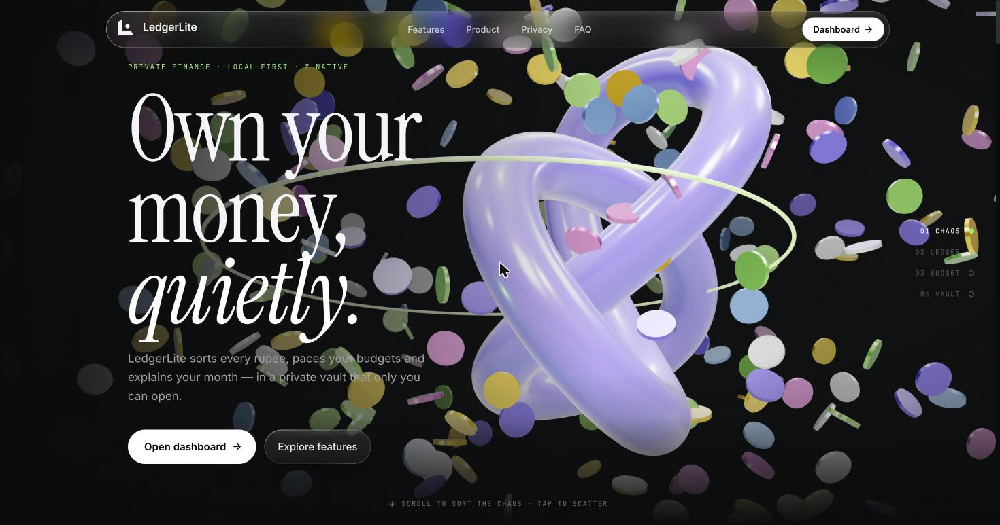
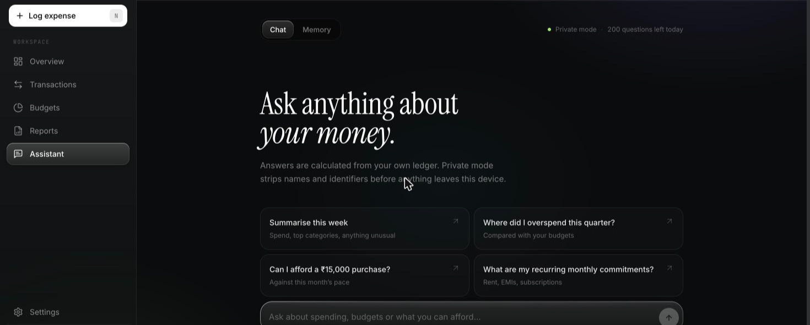

<div align="center">


# LedgerLite

**Own your money, quietly.**

A premium, privacy-first personal finance manager for India — smart categorisation, 50/30/20 budgets,<br/>
period reports and a Gemini assistant, wrapped in a calm, Apple-grade interface.

<p>
  <a href="https://ledgerlite-xi.vercel.app"><strong>Live app →</strong></a>
  &nbsp;·&nbsp;
  <a href="#-quick-start">Quick start</a>
  &nbsp;·&nbsp;
  <a href="#-two-modes-one-codebase">Two modes</a>
  &nbsp;·&nbsp;
  <a href="#-deploy-your-own">Deploy</a>
</p>

<p>
  
  
  
  
  
  
  
</p>



</div>

<br/>

## ✦ Highlights

<table>
<tr>
<td width="50%" valign="top">

**Type it like a text message**<br/>
<sub>“swiggy 420 dinner yesterday upi” becomes a categorised, dated transaction — offline parser first, Gemini only when you enable it.</sub>

**Budgets with a pulse**<br/>
<sub>50/30/20 envelopes, live pace tracking against an ideal burn line, rollovers and suggestions from your own history.</sub>

**Reports you’d actually read**<br/>
<sub>Month, quarter, half-year or Indian financial year (April–March) packs with Excel, CSV and print-ready PDF export.</sub>

</td>
<td width="50%" valign="top">

**Gemini, on a leash**<br/>
<sub>An agentic assistant that answers with tool-verified calculations over your ledger, remembers only what you approve, and sees sanitised data.</sub>

**Three-tier categorisation**<br/>
<sub>Your rules → a merchant dictionary → optional AI. Correct a category once and LedgerLite learns the rule.</sub>

**Private by architecture**<br/>
<sub>Local-first by default; on the hosted site each user gets an owner-only cloud vault. Bring-your-own Gemini key.</sub>

</td>
</tr>
</table>

<div align="center">

<br/><sub>Liquid-glass navigation, a sliding active capsule, and the Assistant’s empty state.</sub>
</div>

<br/>

## ✦ Design

LedgerLite borrows the hush of a midnight gallery: a near-black canvas, whisper-weight **Instrument Serif** headlines, **Inter** for interface text and **JetBrains Mono** for data labels, with iris and lime as the only signals.

- **Three.js landing** — 240 instanced coins and an iridescent ribbon morph from *chaos → ledger → budget → vault* as you scroll (Lenis + GSAP), with reduced-motion and no-WebGL fallbacks.
- **Liquid glass** — translucent controls with a specular rim and top sheen; Chromium adds edge refraction through an SVG displacement filter in `backdrop-filter`. Glass is reserved for the navigation layer so numbers stay legible.
- **Motion that flows** — View Transitions between pages on Apple’s spring curve, a single glass capsule that glides between nav items, and segmented controls whose thumb slides between options.
- **Accessible** — keyboard navigation (including arrow keys in segmented controls), visible focus, pinch-zoom, `prefers-reduced-motion` respected throughout.

## ✦ Two modes, one codebase

The storage mode is chosen by the environment — nothing to fork.

| | **Local mode** — clone & `npm run dev` | **Hosted mode** — the website |
|---|---|---|
| Activates when | No Firebase config is present | Built on Vercel, or `VITE_FIREBASE_*` is set |
| Accounts | On-device (PBKDF2-hashed, this browser only) | Firebase Auth — email/password and Google |
| Data | IndexedDB in your browser | Per-user Firestore vault at `users/{uid}/…` (named database `ledgerlite`), cached while signed in, deleted on sign-out |
| First run | Six months of demo data | An empty vault — sample data is opt-in from Settings |
| Gemini key | Settings, or `VITE_GEMINI_API_KEY` in `.env` | Each user adds their own in Settings |
| Offline | Full PWA offline support | Needs a connection to open the vault |

`firestore.rules` lets a signed-in user read and write only their own `users/{uid}` subtree; everything else is denied.

## ✦ Quick start

```bash
git clone https://github.com/satiricalguru/ledgerlite.git
cd ledgerlite
npm install
npm run dev          # http://localhost:5173 — local mode, no accounts needed
```

```bash
npm test             # 180 unit tests (Vitest)
npm run build        # type-check + production build with service worker
npm run preview      # serve the production build
```

Optional: copy `.env.example` to `.env` and add `VITE_GEMINI_API_KEY` (from [Google AI Studio](https://aistudio.google.com/apikey)) to try AI features locally.

## ✦ Deploy your own

1. **Firebase** — create a project and a Web app, then:
   - create a Firestore database (named `ledgerlite`, or set `VITE_FIREBASE_DATABASE_ID`);
   - enable **Email/Password** and **Google** under *Authentication → Sign-in method*;
   - add your domain under *Authentication → Settings → Authorised domains*.
2. **Rules** — `npx firebase-tools deploy --only firestore:rules --project <project-id>`
3. **Config** — put your Web app config in `src/config/hostedFirebase.ts` (used automatically on Vercel builds), or set `VITE_FIREBASE_API_KEY`, `VITE_FIREBASE_AUTH_DOMAIN`, `VITE_FIREBASE_PROJECT_ID`, `VITE_FIREBASE_APP_ID`.
4. **Vercel** — import the repository (framework: Vite). `vercel.json` handles SPA routing, security headers and the popup-friendly `Cross-Origin-Opener-Policy` that Google sign-in needs. Don’t set `VITE_GEMINI_API_KEY` in production.

> Firebase web config is public by design; access is enforced by security rules and the authorised-domains list.

## ✦ Under the hood

| Layer | Choice |
|---|---|
| UI | React 18, TypeScript, Tailwind CSS, Recharts, lucide icons |
| Motion & 3D | Three.js, GSAP ScrollTrigger, Lenis, View Transitions API |
| Data | Dexie (IndexedDB) behind a `Repository` interface; Firestore write-through sync in hosted mode |
| Auth | Firebase Auth (email/password, Google) or on-device PBKDF2 accounts |
| AI | `@google/genai` with a request queue, daily quotas, model fallback and a privacy sanitiser |
| Export | ExcelJS workbooks, CSV, print-styled PDF |
| Platform | Vite 6, PWA via Workbox, Vercel |

```
src/
├── components/        layout (shell, sidebar, header, bell), auth guard, brand, shared controls
├── data/              Dexie schema, repository, seed data, cloud vault (Firestore sync)
├── features/          landing · auth · dashboard · transactions · budgets · reports · assistant · settings
├── lib/               auth, periods & financial year, categoriser, Gemini agent, CSV, export, backup
└── styles/            design tokens, liquid glass, view transitions
```

The repository abstraction keeps the app portable: every screen talks to one `repository`, which points at the on-device vault or the signed-in user’s cloud vault.

## ✦ Privacy

- Local mode keeps everything in your browser; nothing is uploaded.
- Hosted mode stores each ledger in an owner-only Firestore vault, encrypted at rest by Google Cloud.
- AI features are optional and use your own key. With **Private mode** on, names, notes and identifiers are stripped before a summary is sent to Google.
- One-click JSON backup and restore from Settings.

LedgerLite is a personal finance tool, not financial advice.

<div align="center">
<br/>

<br/>
<sub>Made with care in India · <a href="https://ledgerlite-xi.vercel.app">ledgerlite-xi.vercel.app</a></sub>
</div>
